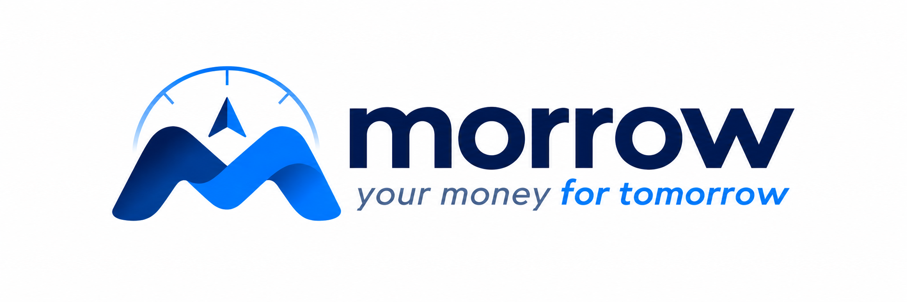
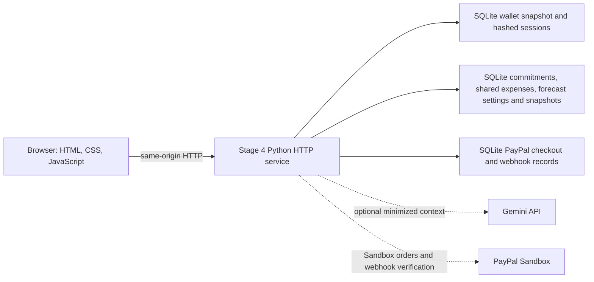
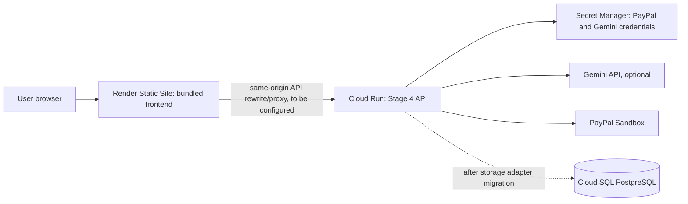

# Morrow



**your money for tomorrow**

Morrow is a personal finance app that brings your wallet, shared expenses, recurring commitments, and financial forecasts into one clear view. It helps you understand what is available today and plan for what comes next.

**Repository:** [github.com/CR1TIC47/morrow](https://github.com/CR1TIC47/morrow)

The current application is **Stage 4** in [`stage-4/`](stage-4/). Stages 1–3 are preserved as earlier, independently runnable project builds. They are useful for understanding the product's history and its export/import compatibility; Stage 4 is the only build that includes the complete current feature set.

> **Project status:** this repository contains a tested application and a proposed deployment design. It does not claim a live deployment, real-money transfer integration, production certification, or a PostgreSQL-backed Cloud Run service. See [deployment status and blockers](#proposed-google-cloud-deployment) before deploying.

## What Morrow helps with

Wallet balances alone do not show what is already committed, what friends owe, or how much room remains for an additional purchase. Morrow brings those separate views together while keeping the forecast calculation deterministic and showing when its history is insufficient.

## Features

- **Wallet and transactions:** account signup/login, handle-based simulated payments, requests, activity, statements, payment corrections, refunds, and idempotent money operations.
- **Holds:** reserve funds, capture them in parts, void them, or allow them to expire. Available funds account for open holds.
- **Recurring commitments:** schedule bills and subscriptions, track due occurrences, and record a payment reference without pretending the entry moved wallet funds.
- **Shared expenses and reimbursements:** split a recorded expense among participants and record partial receipts. A reimbursement record is bookkeeping; it does not credit the wallet.
- **Financial forecasting:** deterministic monthly outflow estimates based on wallet statement history, active commitments, current month spending, and configured savings targets.
- **Safe-to-Spend:** a server-calculated estimate that subtracts unpaid commitments, forecast remaining variable outflows, savings target, and safety buffer from available wallet funds. It is unavailable when required history or inputs are incomplete.
- **Gemini financial companion:** optional, server-side explanations of a minimized financial summary. Gemini cannot call tools or change records; Morrow displays verified figures separately and falls back when the provider is unavailable.
- **PayPal Sandbox checkout:** create, inspect, capture, and reconcile merchant checkout orders through PayPal Sandbox. This is separate from internal wallet transfers and shared-expense reimbursements.

## Screenshots and demo

No verified Morrow screenshots or demo URL are included yet. The signed-out page uses illustrative CSS previews, not product screenshots.

- **Landing page:** _Screenshot placeholder — add a real capture from the current Stage 4 UI._
- **Wallet and forecast:** _Screenshot placeholder — use synthetic data and redact account details._
- **Commitments and shared expenses:** _Screenshot placeholder — use synthetic data._
- **Demo video:** _No current Morrow demo link._

## Architecture

### Current application



The Stage 4 service uses Python's `ThreadingHTTPServer` and standard-library request handling. It serves the bundled UI and JSON API from one origin. Wallet state is serialized through SQLite transactions; finance records and PayPal operations use SQLite stores. Gemini and PayPal are optional external services configured on the server.

The financial stores use SQLite files. In the Docker example, the PayPal and finance stores share `/data/paypal.sqlite3`, and the wallet uses the separate `/data/paypal-wallet.sqlite3`. Wallet and finance databases must remain separate. Back up SQLite databases using SQLite-aware tooling, including their WAL state.

### Proposed Google Cloud deployment

The requested Render + Cloud Run layout is a **target design**, not a checked-in or verified deployment configuration:



Cloud Run's writable container filesystem is ephemeral, while the current backend stores its databases in SQLite files. Cloud SQL PostgreSQL is not a drop-in target for these SQLite stores: a database adapter, schema migration, and migration/recovery plan are prerequisites. The current UI also assumes same-origin API paths and the service does not configure CORS or a separate API base URL; the Render rewrite/proxy and browser flows must be implemented and tested before splitting frontend and backend hosts. Do not deploy the current SQLite files on Cloud Run's local filesystem and treat them as durable.

For the proposed topology, Render would host the static `stage-4/web/` assets and proxy API paths to Cloud Run. Cloud Run would run the container, retrieve credentials from Secret Manager via a least-privilege service identity, and connect to a durable managed database after the application is migrated from SQLite. The current repo does not include Render rules, Cloud Run service definitions, Secret Manager bindings, Cloud SQL migrations, or infrastructure-as-code. See [Google's Cloud Run container filesystem contract](https://cloud.google.com/run/docs/container-contract), [Cloud Run secret configuration](https://cloud.google.com/run/docs/configuring/services/secrets), [Cloud Run and Cloud SQL connection guide](https://cloud.google.com/sql/docs/postgres/connect-run), and [Render static-site rewrites](https://render.com/docs/redirects-rewrites).

For a future Cloud Run deployment, store `PAYPAL_CLIENT_ID`, `PAYPAL_CLIENT_SECRET`, `PAYPAL_WEBHOOK_ID`, and (if enabled) `GEMINI_API_KEY` as Secret Manager secrets, then expose them to the container as environment variables through Cloud Run's secret integration and a least-privilege service identity. Keep non-secret settings such as `PAYPAL_BASE_URL`, `PORT`, and database paths in service configuration. This is deployment guidance only; no secrets, IAM bindings, or Cloud Run service are configured by this repository.

## Technology

| Area | Technology in the current application |
|---|---|
| Runtime | Python 3.12; Python standard library for HTTP, JSON, SQLite and outbound HTTP |
| Backend | `ThreadingHTTPServer`, domain/service modules, SQLite persistence |
| Frontend | Bundled HTML, CSS and vanilla JavaScript; no frontend build step |
| AI provider | Optional Gemini API over HTTPS using the standard library |
| Payments | PayPal Orders API in Sandbox mode |
| Container | `python:3.12-slim`, non-root runtime user, `/data` volume, `/health` Docker health check |
| Tests | pytest and pytest-playwright; Chromium for browser tests |

No ORM, web framework, JavaScript package manager, or runtime Python package is required by the Stage 4 Docker image. `stage-4/requirements-dev.txt` contains test-only dependencies.

## Repository map

```text
stage-1/                 Earlier core wallet service and tests
stage-2/                 Earlier UI and authorization/hold service
stage-3/                 Earlier history and correction service
stage-4/                 Current Morrow application
  app.py                 HTTP routes, service orchestration and API behavior
  wallet_store.py        durable wallet snapshots, sessions and auth throttles
  finance_store.py       finance schema and transactional finance records
  forecast_engine.py     deterministic forecast and Safe-to-Spend calculation
  gemini_provider.py     optional read-only Gemini client
  paypal.py              PayPal Sandbox adapter
  payments_store.py      durable PayPal checkout/webhook store
  web/                   served UI assets
  tests/                 API, persistence, finance, provider and browser tests
docs/architecture/       proposed future architecture and decision records
room.json                 preserved historical session archive; not a runtime input
SECURITY.md               current Stage 4 security notes and known limitations
```

The Stage 1–3 copies and the factory/architecture artifacts are intentionally retained. They document earlier builds and future design work; they are not imported into the current Stage 4 runtime.

## Local development

Install Python 3.12 or later. The service itself has no third-party runtime dependencies.

### Run the current service

From the repository root:

```sh
cd stage-4
mkdir -p data
PAYPAL_DB_PATH="$PWD/data/paypal.sqlite3" \
MORROW_FINANCE_DB_PATH="$PWD/data/paypal.sqlite3" \
MORROW_WALLET_DB_PATH="$PWD/data/wallet.sqlite3" \
PORT=8080 python app.py
```

On PowerShell:

```powershell
cd stage-4
New-Item -ItemType Directory -Force data | Out-Null
$env:PAYPAL_DB_PATH = (Join-Path (Get-Location) "data/paypal.sqlite3")
$env:MORROW_FINANCE_DB_PATH = $env:PAYPAL_DB_PATH
$env:MORROW_WALLET_DB_PATH = (Join-Path (Get-Location) "data/wallet.sqlite3")
$env:PORT = "8080"
python app.py
```

Open [http://localhost:8080](http://localhost:8080). `/health` checks wallet database integrity. Local database files are ignored by Git. Never put real credentials in tracked files. The test-only `/_test/*` endpoints are disabled unless `POCKETFUL_ENABLE_TEST_ROUTES=1` is set; do not enable them on a public service. This is a legacy configuration identifier retained for compatibility.

### Build and run the container

```sh
cd stage-4
docker build -t morrow-stage-4 .
docker run --rm -e PORT=8080 -p 8080:8080 \
  -v morrow-data:/data --env-file .env morrow-stage-4
```

Create `.env` locally from [`stage-4/.env.example`](stage-4/.env.example), replace placeholders with PayPal Sandbox credentials, and keep the file untracked. The named volume stores the SQLite databases. The container runs as a non-root user.

## PayPal Sandbox setup

1. Create a PayPal developer account and a Sandbox REST application.
2. Put its Sandbox client ID and secret in the local environment or secret manager as `PAYPAL_CLIENT_ID` and `PAYPAL_CLIENT_SECRET`.
3. Keep `PAYPAL_BASE_URL` set to `https://api-m.sandbox.paypal.com`; the application rejects non-Sandbox PayPal hosts.
4. Set `POCKETFUL_PUBLIC_URL` to the HTTPS public URL the buyer browser can reach. For local testing, localhost is allowed. This environment variable retains its legacy name for compatibility.
5. For webhook handling, configure the listener URL as `<public-url>/webhooks/paypal`, then set its Sandbox webhook ID as `PAYPAL_WEBHOOK_ID`.
6. Test with Sandbox accounts only. Checkout represents merchant checkout; it does not deposit into Morrow wallets or automatically settle shared expenses.

PayPal checkout is optional. The app can start without credentials, but checkout endpoints will be unavailable.

## Gemini financial companion

Gemini is optional. Set `GEMINI_API_KEY` on the backend and optionally set `GEMINI_MODEL` (default `gemini-2.5-flash`) and `GEMINI_TIMEOUT_SECONDS` (default `12`, clamped by the service). Without a usable key or when the provider fails, Morrow returns a deterministic fallback.

The companion receives a bounded user question and minimized, authenticated-user financial context. It has no mutation tools. Generated numeric/currency claims are rejected; deterministic figures are returned separately. Review Google's data-handling terms and applicable privacy obligations before sending real financial data to an external provider.

## Configuration reference

Values below are names and safe examples, not credentials. See [`stage-4/.env.example`](stage-4/.env.example).

| Variable | Purpose | Default / notes |
|---|---|---|
| `PORT` | HTTP listen port | `8080` |
| `PAYPAL_CLIENT_ID` | PayPal Sandbox REST client ID | Unset disables checkout |
| `PAYPAL_CLIENT_SECRET` | PayPal Sandbox secret | Unset disables checkout |
| `PAYPAL_BASE_URL` | PayPal API host | `https://api-m.sandbox.paypal.com`; Sandbox only |
| `PAYPAL_WEBHOOK_ID` | Sandbox webhook ID for signature verification | Optional; needed to verify webhooks |
| `PAYPAL_MERCHANT_LABEL` | Checkout label shown by the UI | `Morrow Sandbox merchant` |
| `POCKETFUL_PUBLIC_URL` | Public buyer-return/webhook origin | Legacy variable name retained for compatibility |
| `PAYPAL_DB_PATH` | SQLite path for checkout/webhook persistence | Docker: `/data/paypal.sqlite3`; local default is a temp path |
| `MORROW_FINANCE_DB_PATH` | SQLite path for commitments, shared expenses and forecast preferences/snapshots | Defaults to `PAYPAL_DB_PATH` |
| `MORROW_WALLET_DB_PATH` | Separate SQLite path for wallet state and sessions | Docker: `/data/paypal-wallet.sqlite3`; must differ from PayPal/finance paths |
| `MORROW_WALLET_MIGRATION_FILE` | One-time import of a pre-persistence Stage 4 export | Only used when the wallet database is empty |
| `GEMINI_API_KEY` | Optional Gemini API key | Unset uses deterministic fallback |
| `GEMINI_MODEL` | Gemini model name | `gemini-2.5-flash` |
| `GEMINI_TIMEOUT_SECONDS` | Provider request timeout | `12` seconds by default; capped by the service |
| `POCKETFUL_ENABLE_TEST_ROUTES` | Enables test-only reset/import/export routes | Must remain unset outside isolated tests |

## API and data behavior

The current API is not described by an OpenAPI document. Key routes include:

- Authentication: `POST /auth/signup`, `POST /auth/login`, `POST /auth/logout`.
- Wallet: `GET /me`, `POST /payments`, `POST /requests`, `POST /splits`, `GET /activity`, `GET /statement`, `GET /authorizations`.
- Planning: `/commitments`, `/shared-expenses`, `GET /forecast`, `GET /safe-to-spend`, and `GET/PATCH /forecast/settings`.
- Checkout and assistant: `/paypal/checkouts`, `POST /webhooks/paypal`, `POST /ai/proposals`, `POST /ai/companion`.

Wallet and finance mutation semantics, request fields, idempotency, forecast formulas, and privacy limits are documented in [`stage-4/FINANCE_API.md`](stage-4/FINANCE_API.md). Local startup and migration guidance is in [`stage-4/RUN.md`](stage-4/RUN.md). See [`SECURITY.md`](SECURITY.md) for controls and limitations.

## Tests and verification

Run the complete current Stage 4 suite:

```sh
cd stage-4
python -m pip install -r requirements-dev.txt
python -m playwright install chromium
python -m pytest -q
```

Run the complete suite from `stage-4/` as shown above. This repository does not make a test count or pass claim here; check the output from your own run.

Earlier stages have their own suites under `stage-1/tests`, `stage-2/tests`, and `stage-3/tests`; run them from their respective directories when changing historical builds.

## Security and privacy

- The wallet database is separate from PayPal/finance data by default. Protect all SQLite database files and WAL files with restrictive filesystem access and SQLite-aware backups.
- The wallet store uses SQLite `BEGIN IMMEDIATE` transactions, validates balances against payment history, and persists bearer sessions as token hashes with expiry and revocation.
- The browser stores its bearer token in `localStorage`; this increases the impact of an XSS defect. The app uses a restrictive Content Security Policy, but an HttpOnly cookie session is not implemented.
- Passwords use salted `scrypt` hashes; authentication attempts are throttled. API access must use HTTPS in any public deployment.
- Gemini receives minimized per-user context only when configured. Do not include credentials or secrets in prompts. Model output cannot perform transactions.
- PayPal credentials and Gemini keys belong in a secret manager for hosted deployments, never in the repository or frontend bundle.
- The `/_test/*` reset/import/export routes are disabled by default and must remain disabled in deployed environments.

Read [`SECURITY.md`](SECURITY.md) for the full threat model and limitations.

## Known limitations and deployment blockers

- Wallet payments are simulated internal balance movements. PayPal supports merchant checkout, not peer-to-peer wallet funding or transfer in this implementation.
- SQLite is the only implemented persistence backend. Cloud Run's local filesystem is ephemeral and Cloud SQL PostgreSQL is not wired into the application. A PostgreSQL adapter and tested data migration are required before using the proposed Cloud Run + durable database topology.
- The current UI and API are same-origin. A separate Render frontend needs a tested API proxy/rewrite or explicit API origin and CORS support; no such deployment config is included.
- Statement snapshot tokens, pending assistant proposals, and companion rate counters are process-local. Multi-instance behavior needs shared persistence or other coordination before horizontal scaling.
- Forecasts require three complete prior calendar months and use only Morrow wallet history. They do not see bank accounts, cash, or categorized spending; Safe-to-Spend may be unavailable until enough history exists.
- Commitment payments and reimbursements are user-recorded and do not prove external bank transfers. They do not automatically move wallet balances.
- Gemini is optional and requires provider and privacy review. No user profile/security settings, bank feed, or real account linking are implemented.
- There is no deployment URL, infrastructure-as-code, CI deployment workflow, or production operations evidence in this repository.

## Contributing

Contributions are welcome. Before proposing a change:

1. Open an issue describing the problem or proposed behavior.
2. Keep wallet and finance mutations atomic and idempotent; add regression tests for changed behavior.
3. Run `python -m pytest -q` from `stage-4/` for current-app changes. Install Chromium first for browser tests.
4. Update API, security, and run documentation when behavior or configuration changes.
5. Keep credentials, databases, logs, screenshots containing personal data, and generated files out of commits.

Please preserve the earlier stage folders unless a change is specifically about those historical builds.

## License

This project is licensed under the [Apache License 2.0](LICENSE). Test-only dependency license information is documented in [THIRD_PARTY_NOTICES.md](THIRD_PARTY_NOTICES.md).
