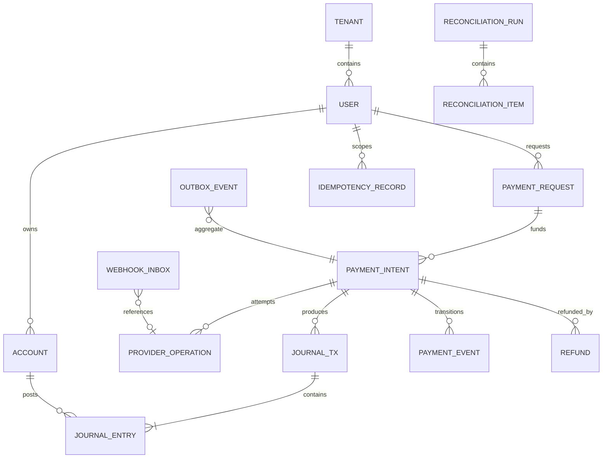

# Data model proposal

All IDs are UUID/ULID opaque identifiers. Tenant and user foreign keys are mandatory where applicable. Monetary fields are signedness-constrained integer minor units with ISO currency code; never float. Timestamps are `timestamptz` UTC. Schema details remain subject to legal product/funds-flow decisions.

## Tables and key constraints

| Table | Important fields / constraints |
|---|---|
| `tenants` | `id`, status, region/policy references; unique external identity mapping |
| `users` | `tenant_id`, normalized email unique per tenant, handle unique per tenant, password hash/status, created/updated/version |
| `sessions` | user, hashed refresh secret, family, expiry, revoked/reuse timestamps, device metadata minimized |
| `accounts` | owner, account type, currency, status, version; uniqueness on owner/type/currency as applicable |
| `account_balances` | account PK, posted and reserved integer amounts, sequence/version, last ledger tx; rebuildable projection |
| `journal_transactions` | immutable ID, currency, source type/source ID/posting kind unique, effective_at, recorded_at, reversal_of, actor, reason, correlation ID |
| `journal_entries` | immutable tx/account refs, debit_minor or credit_minor exactly one > 0, entry sequence; index account + time + id |
| `payment_intents` | actor/tenant, amount_minor, currency, purpose, state/version, expiry, confirmation digest, provider selection, idempotency ref |
| `provider_operations` | intent, provider, operation type, stable request ID unique, provider resource IDs, state, attempt count, last error class, request/response digest |
| `payment_events` | intent ID, sequence unique, from/to state, event type, actor/source, recorded/effective time, correlation; append-only |
| `payment_requests` | requester/payer, amount/currency, status, expiry, paid intent; ownership and state constraints |
| `refunds` | original capture/intent, amount, provider operation, state; cumulative cap checked under lock |
| `holds` | account, amount, captured/released, expiry, state/version, source intent; reserve projection |
| `idempotency_records` | principal, route/operation, key hash, request hash, state, response reference/status, expiry; composite unique |
| `webhook_inbox` | provider, event ID unique, signature verified, body hash, normalized payload, receive/process state, attempts |
| `outbox_events` | event ID, aggregate ID/version, type/schema version, payload, created/published/attempts/next retry; index unpublished next retry |
| `audit_events` | actor/service, action, target, outcome, reason, request/correlation IDs, timestamp; append-only and PII-minimized |
| `reconciliation_runs/items` | provider/account window, match keys, expected/observed values, discrepancy classification, resolution actor/approval |
| `statement_snapshots` | user, filter hash, as_of/known_at, result reference, expiry; immutable snapshot paging semantics |

## Partitioning and indexes

Start unpartitioned until query/retention evidence. At high volume, range-partition append-heavy `journal_entries`, `payment_events`, `audit_events`, and inbox/outbox by `recorded_at` month; IDs/source uniqueness constraints must include partition key or use a separate nonpartitioned uniqueness registry. Avoid partitioning mutable user/account tables. Index journal `(account_id, recorded_at, id)` and `(account_id, effective_at, recorded_at)` only for proven query patterns; provider IDs and idempotency keys unique; partial index pending outbox. Archive cold immutable records to encrypted object storage only with verified restore/search policy; never remove records required for legal/audit obligations.

