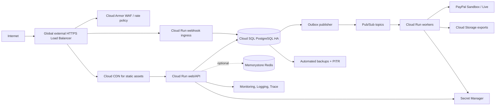

# GCP deployment design

## Topology

GCP equivalents named in the mission are appropriate: Cloud Run, Cloud SQL PostgreSQL HA, Memorystore, Pub/Sub, Cloud Storage, Secret Manager, Cloud Load Balancing, Cloud Armor, Cloud CDN, Cloud Monitoring/Logging/Trace; BigQuery for curated analytical data, not operational ledger queries. A separate API Gateway is optional: use it where centralized API key/quotas/version policy is needed; avoid needless duplicate gateways behind the load balancer. Cloud Run concurrency is configurable and must be tuned to application/thread/connection limits; Cloud SQL built-in connections from Cloud Run have per-instance limits, so autoscaling and DB pool budgets must be coordinated ([Cloud Run concurrency](https://docs.cloud.google.com/run/docs/about-concurrency), [Cloud SQL quotas and limits](https://docs.cloud.google.com/sql/docs/quotas)). Cloud SQL regional HA uses primary/standby zones and failover interrupts existing connections; the application must reconnect ([Cloud SQL HA](https://docs.cloud.google.com/sql/docs/postgres/high-availability)).

## Environments and IAM

- **Development:** local Docker Compose (Postgres/Redis optional), PayPal Sandbox, fake email sink, synthetic users. No production data/secrets.
- **Staging:** isolated GCP project, regional Cloud Run, small Cloud SQL single-zone initially for cost or HA if validating failover, Sandbox credentials, masked test data.
- **Production:** separate project/VPC, Cloud SQL HA and PITR, private IP/connector, least-privilege identities, live provider account and monitored deployment gates. No shared secrets or DB.

Separate service accounts: runtime API (DB connect, specific Secret access, outbox publish), webhook (DB/inbox only), worker (DB + named topic/subscription + provider secret), migration job (schema owner, manual gated), deployer (release only). Use workload identity; no long-lived JSON keys. Restrict ingress to LB/webhook path as possible; egress controls for provider/model endpoints.

## Demo and cost controls

For a hackathon, begin with one region, low-minimum Cloud Run instances, bounded max instances, a small PostgreSQL instance, Sandbox provider, and no Memorystore until a measured need. A single-zone DB is a demo compromise, not production resilience. Frontend may be hosted on Cloud Storage/CDN or packaged with API. Do not provision automatically in this architecture phase. Full HA Cloud SQL, global CDN/WAF, Redis and high worker concurrency can dominate cost; see [cost estimate](COST_ESTIMATION.md).

## Operations

Cloud SQL automated backups/PITR, scheduled restore validation, and documented RPO/RTO. Cloud Run revision-based rollout, staged traffic, health checks and rollback to prior image; migrations are backward-compatible expand/contract. Secret Manager versions rotate independently. Pub/Sub retention, retry and dead-letter topics configured per event class. Terraform/IaC later with plan review and budget alerts; no resource creation until explicit deployment approval.

