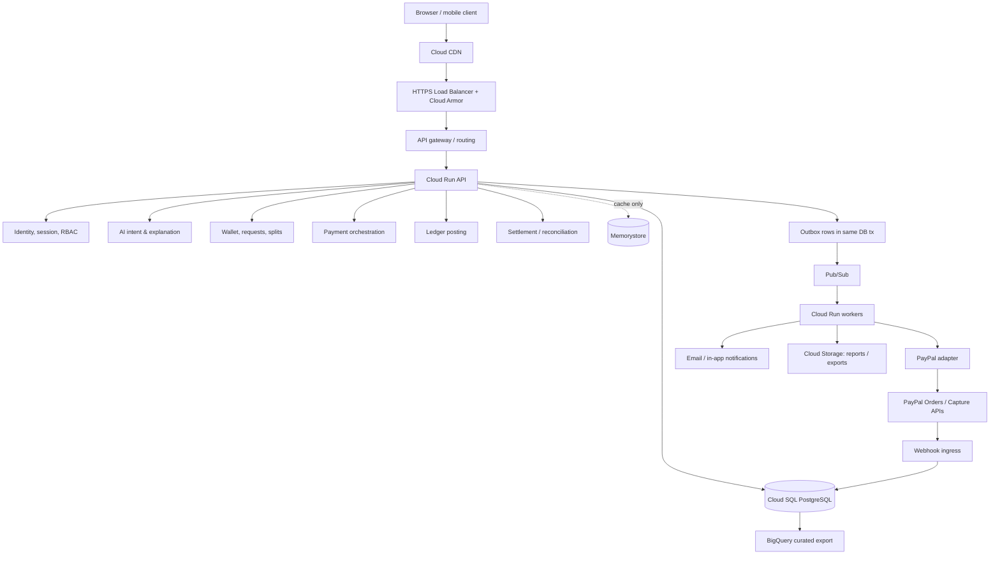

# High-level design

## Logical components

The first production shape is a modular application, not a fleet of independently owned services. API, worker and webhook processes may scale separately while using one codebase and explicit module boundaries.



## Responsibilities and trust boundaries

- **Edge:** TLS, request size/rate controls, WAF policy, routing. Authentication remains application-enforced.
- **API:** schema validation, identity/authorization, business commands and reads; no model or client can write ledger tables directly.
- **AI module:** untrusted text to typed proposal and explanations. No DB write credentials. Calls only allowlisted application tools.
- **Domain modules:** payment lifecycle, wallet/requests, ledger and settlement; each owns transaction policy and domain events.
- **Persistence:** PostgreSQL is source of truth. Redis is disposable acceleration/rate-limit state, never a balance or correctness authority.
- **Async:** outbox publisher and Pub/Sub workers deliver at least once. Consumers deduplicate by event/operation IDs; delivery is not exactly once.
- **Provider boundary:** PayPal adapter owns API authentication, idempotent request IDs, mapping and provider errors. Webhook signature must be verified before it can affect workflow state.
- **Analytics:** read-only, delayed/derived copy; never command path or user-visible balance authority.

## AI proposal-to-payment sequence

```mermaid
sequenceDiagram
  actor User
  participant UI as Web client
  participant API as Morrow API
  participant Agent as AI intent module
  participant Policy as Policy/domain services
  participant DB as PostgreSQL
  participant Worker as Payment worker
  participant PayPal
  User->>UI: "Split dinner $120 between four people"
  UI->>API: POST /v1/assistant/proposals
  API->>Agent: text + minimal authorized context
  Agent-->>API: typed proposal (no execution)
  API->>Policy: validate identities, currency, amounts, limits
  Policy-->>API: plan + warnings + exact digest
  API-->>UI: preview, participants, per-person shares, expiry
  User->>UI: explicit confirm
  UI->>API: POST /v1/payment-intents/{id}/confirm + idempotency key
  API->>DB: lock/check proposal, permission, digest, limits; create intent + outbox
  DB-->>API: committed durable intent
  API-->>UI: pending approval / PayPal link
  Worker->>PayPal: create order with stable request ID
  PayPal-->>Worker: order + buyer approval URL
  User->>PayPal: approve hosted checkout
  PayPal-->>UI: return to Morrow
  UI->>API: refresh intent status
  PayPal->>API: signed webhook (possibly duplicate)
  API->>DB: verify, dedupe inbox, persist transition + ledger/outbox atomically
  Worker->>PayPal: capture when workflow permits
  API-->>UI: confirmed status and ledger reference
```

## Deployment units

1. **Web/API** — latency-sensitive, stateless Cloud Run service.
2. **Webhook ingress** — same domain code, separate route/service identity and concurrency policy; durable inbox before acknowledgement.
3. **Workers** — outbox publishing, provider actions, reconciliation, notifications; separate scaling and bounded concurrency.
4. **PostgreSQL** — transactional source of truth; HA in production.
5. **Redis** — optional rate limits/cache only; bypass gracefully.

Extraction from the modular monolith is a measured decision. Strong candidates later include webhook ingress and analytics ingestion if their scaling/security profile diverges.

