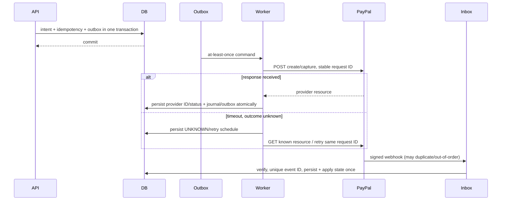

# Payment orchestration

## Domain model and state

Separate a customer **payment intent** from provider **order**, **authorization/capture**, and ledger postings. An intent can own multiple attempts only under explicit recovery rules; one confirmed economic effect maps to one unique provider operation and one unique journal source.

Recommended states: `CREATED → REQUIRES_APPROVAL → APPROVED → CAPTURE_PENDING → CAPTURED`; alternatives include `PENDING` (provider outcome unknown), `FAILED` (terminal attempt), `CANCELLED`, `EXPIRED`, `PARTIALLY_REFUNDED`, `REFUND_PENDING`, `REFUNDED`. `AUTHORIZED` is distinct from approved buyer intent when the provider has actually placed an authorization. Never treat browser return as proof of payment. Terminal results may receive later refund/dispute events without rewriting their historical capture.

Allowed transitions are explicit and versioned. Invalid state transitions return conflict and emit audit diagnostics. A stale client cannot force a transition by supplying a status.

## Provider port

```python
class PaymentProvider(Protocol):
    async def create_order(self, request: CreateOrder, request_id: str) -> ProviderOrder: ...
    async def get_order(self, provider_order_id: str) -> ProviderOrder: ...
    async def capture_order(self, provider_order_id: str, request_id: str) -> Capture: ...
    async def refund_capture(self, capture_id: str, amount_minor: int, request_id: str) -> Refund: ...
    async def verify_webhook(self, headers: Mapping[str, str], body: bytes) -> VerifiedEvent: ...
```

Amounts crossing provider boundary are formatted with currency-specific exponent and validated against provider limits. Store provider IDs/status/raw response digest and redacted normalized metadata; do not persist access tokens or unnecessary webhook PII. Provider configuration and supported features are capability-checked.

## PayPal flow

Use official PayPal Orders APIs and Sandbox credentials. Server creates order with `intent=CAPTURE`, amount/currency, server-owned `custom_id`/reference and stable `PayPal-Request-Id`; buyer approves on PayPal-hosted approval URL. Server validates return identifiers by retrieving authoritative order details. Capture is a server-to-server command after explicit user approval where required. Persist provider order/capture IDs and state transitions. Verify webhook using PayPal's verification endpoint/API and configured webhook ID, then deduplicate by PayPal event ID. Webhook can arrive before redirect, after polling, more than once, or out of order; retrieve provider resource where necessary and apply monotonic transition rules. PayPal documents `PayPal-Request-Id` idempotency and retention of up to 45 days; Morrow must retain its operation identity and reconcile beyond the provider dedupe window ([PayPal REST requests](https://developer.paypal.com/api/rest/requests/), [making REST API requests](https://developer.paypal.com/api/make-api-requests)).

Sandbox vs live credentials and endpoints are environment-isolated. Do not store PAN/CVV; hosted checkout keeps card data with PayPal.

## Durable workflow; no distributed ACID

Database and PayPal cannot commit atomically. Transaction A records intent, idempotency and outbox action. Worker calls provider outside DB transaction using stable request ID. Transaction B records observed result, inbox/event, journal effect and next outbox actions. If response is lost, mark `PENDING/UNKNOWN`, query provider by known order/capture identifier or replay same idempotent request; never create a new order/capture merely because local timeout occurred. Reconciliation resolves ambiguous outcomes.



## Inbox/outbox and retries

- Outbox rows have UUID, aggregate ID/version, event type/schema version, payload, created/published timestamps, attempts and next retry. Publisher may publish twice if ack is lost; consumers dedupe by event ID and operation key.
- Webhook inbox has `(provider, provider_event_id)` unique constraint, verification state, received timestamp, body hash and processing state. Acknowledge only after durable insert. Invalid signatures are rejected and rate-limited.
- Retry transient 429/5xx/network failures with capped exponential backoff and jitter, respecting provider retry guidance and `Retry-After`. Validation/auth/business errors are not blindly retried. Exhausted events go to DLQ with alert and safe replay tooling.
- Capture success followed by DB failure is recovered by provider lookup/webhook and idempotent journal source. A posting constraint blocks duplicate ledger effect.

## Refunds, voids and compensation

Refund is a new provider operation and a new reverse ledger transaction, bounded by captured amount less prior refunds. Never delete/modify original capture. Void only a genuinely uncaptured authorization. If a local action must be compensated, create a compensating payment/refund operation and reversal entries; retain full audit chain. Settlement corrections require operator permission, reason, approval threshold and balanced adjustment entries.

## Reconciliation

Scheduled and on-demand jobs compare internal intents/captures/refunds/journal entries to PayPal reports/API resources. Match by provider IDs and currency/amount; flag missing, duplicate, amount mismatch, fee mismatch and stale pending. Reconciliation proposes adjustments; it cannot silently rewrite the ledger. Human review is required for unmatched money-moving adjustments.

