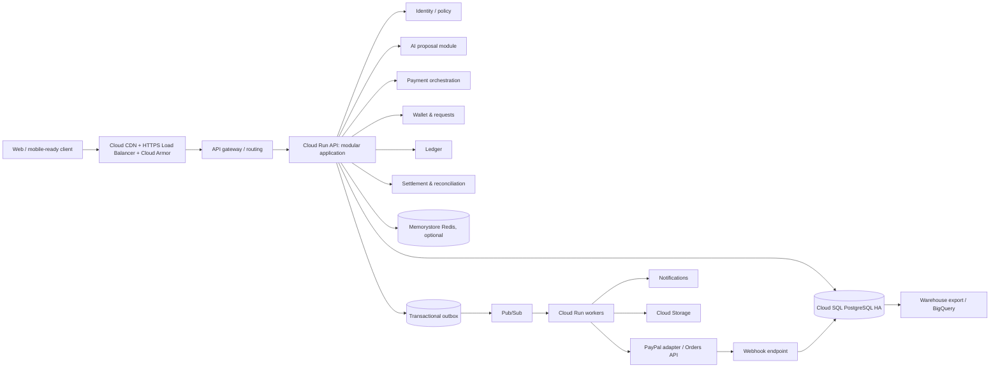

# System design, repository audit and delivery roadmap

## Scope and status

This is a design proposal with an original repository-audit snapshot that predates Morrow Phases 4–6. The current implementation is Stage 4 and is summarized in the root README, Stage 4 run guide, finance API guide, and SECURITY.md. The target design below is not implemented: no PostgreSQL adapter, infrastructure-as-code, or cloud resources have been provisioned.

## Phase 1 — repository audit

### What exists

| Area | Finding |
|---|---|
| Stages | `stage-1` through `stage-4` are independently runnable copies, not separate network services. Stage 2 adds UI/holds, Stage 3 adds effective/recorded history and statements/corrections, Stage 4 adds refunds and correction batches. Each later stage tests import of prior-stage exports. |
| Runtime | One `app.py` per historical stage; Stage 4 is the active Morrow service. It uses Python 3.12 standard library, `ThreadingHTTPServer`, bundled static assets, SQLite modules, optional Gemini and PayPal Sandbox HTTPS calls. Docker uses `python:3.12-slim` and a non-root UID. |
| State | Stages 1–3 keep application state in process memory. Stage 4 persists wallet snapshots, hashed sessions and auth throttles in a versioned SQLite wallet DB; finance preferences/records/snapshots and PayPal checkout/webhook data use SQLite stores. Statement snapshot tokens, pending assistant proposals, and companion rate counters remain process-local. |
| Money | JSON monetary amounts are integer minor units with bounded ranges; currency and minor unit configuration is explicit (EUR/2, JPY/0, BHD/3 in fixture setup). JSON decimal parsing is defensive. Wallet balances are cached fields derived/checked against payment history. This is a single-entry transfer model, not a general double-entry ledger. |
| Invariants | Transfers conserve total wallets; holds reduce available funds; idempotency is scoped to principal/operation/request; settlement/correction batches validate before commit; historical views distinguish effective and recorded time; revisions/refunds append linked records. Stage 4 uses SQLite `BEGIN IMMEDIATE` plus a process lock and revalidates wallet state before commit. |
| API | Stage 4 retains wallet/auth/history routes and adds commitments, shared expenses/reimbursements, forecasts/settings, Safe-to-Spend, PayPal checkout/webhooks, AI proposals, and `/ai/companion`. `/_test/*` routes are available only when the legacy `POCKETFUL_ENABLE_TEST_ROUTES=1` variable is set; keep that variable unset in deployment. Exact payloads and errors are implemented in `stage-4/app.py` and covered by tests. |
| Authentication | Stage 4 uses salted stdlib scrypt hashes, opaque bearer tokens, hashed SQLite session records, a 30-day expiry, logout revocation, and persistent account/IP login/signup throttles. There is no MFA, refresh-token flow, general tenant model, or general role system; settlement operations use an allowlist. |
| Security strengths / release blocker | Bounded request bodies/depth, normalized errors, no CORS, CSP for HTML, `nosniff`, referrer policy, ownership checks, hashed sessions and safe UI `next` handling. UI stores tokens in localStorage; XSS could steal them. Historical Stages 1–3 expose unauthenticated test routes. Stage 4 gates those routes behind an environment flag; enabling it on a public service is a release blocker. |
| Frontend | Vanilla JavaScript + HTML/CSS served by the Stage 4 backend; no React/TypeScript build or package manifest. Current UI includes wallet, requests, splitting, holds, finance planning, PayPal checkout and AI companion flows. |
| Tests | Independent pytest suites remain in each stage. The latest Stage 4 audit run passed 209 tests; this is test evidence, not scale or production-readiness evidence. |
| Dependencies | Stage 4 runtime uses the standard library, including `sqlite3` and `urllib`; pytest/pytest-playwright are test-only dependencies. No FastAPI, SQLAlchemy, Alembic, PostgreSQL driver, Redis/Pub/Sub, Gemini SDK or PayPal SDK is used. |
| Operations | Stage 4 Docker has a `/health` health check and a `/data` volume. SQLite is the only implemented persistence backend. There is no PostgreSQL adapter, infrastructure-as-code, cloud deployment, backup drill, metrics, or tracing implementation. |

### Strengths to preserve

- The existing behavioral contract is unusually rich for a prototype: deterministic split remainder behavior, idempotent retries, hold/capture/void semantics, authorization/ownership checks, immutable revisions and historical query semantics.
- The test suite values adversarial cases: same-key concurrency, stale corrections, atomic batch rejection, malformed HTTP, large imports, snapshot stability and uncertain network outcomes.
- Integer minor units, currency metadata, bounded input and separation of effective and recorded timestamps are good foundations.
- The UI has responsive and accessible details and exposes clear loading/error/empty states.
- Stage copies and export/import make historical compatibility explicit; retain them as reference/compatibility fixtures, not as production deployment topology.

### Principal limitations and migration risks

1. SQLite is file-based; Cloud Run's local filesystem is ephemeral. The app has no shared managed database adapter, and some snapshot/proposal/rate-limit state is process-local. Cloud Run multi-instance deployment needs a durable database migration and shared coordination.
2. A process lock serializes in-process state access, while SQLite `BEGIN IMMEDIATE` serializes wallet database writes. This has not been load-tested across Cloud Run instances and is not a demonstrated scale strategy.
3. Cached wallet balance plus transfer records do not represent balanced accounting entries, provider clearing, fees, liability, settlement or chargeback accounting.
4. Stage 4 database writes use SQLite transactions, but multi-store actions and external PayPal effects do not share a transaction or durable outbox. Reconcile provider outcomes carefully.
5. Stage 4 sessions expire and support logout revocation, but localStorage token storage, no MFA/recovery/refresh lifecycle, and limited signup controls are not a full identity program.
6. **P0 release blocker:** Never enable Stage 4 test reset/import/export routes on a public service. Historical Stages 1–3 have no equivalent environment gate and should not be exposed publicly.
7. Missing organization/tenant boundary, operator roles, step-up approvals, audit trail, risk limits, privacy/retention rules and secrets management.
8. A single-file router/domain/state design is hard to evolve safely. Blind conversion to async endpoints would not solve durable consistency.
9. Browser token storage needs a production threat-model decision; prefer a BFF and secure HttpOnly cookie for same-site browser usage, with CSRF controls.
10. PayPal product scope and legal funds-flow assumptions are undecided. Do not assume a Morrow stored-value wallet can hold, pool or transmit real customer funds without confirming the applicable PayPal product, country availability, licensing and compliance model.
11. Compatibility migration is risky: current wallet balances, timestamps, revision chains and imports need a deterministic one-time conversion and reconciliation before writes are enabled.

## Phase 2 — target architecture

Use a **modular monolith** on FastAPI + Pydantic + SQLAlchemy 2.x/Alembic, backed by PostgreSQL. Domain modules own transaction boundaries; deploy API and independently scalable worker process types from a shared versioned codebase. Extract a service only when a distinct scaling, deployment, data-security or failure-isolation boundary is proven. The complete design is in the domain documents.

## Phase 3 — architecture review and revisions

| Reviewer lens | Challenge | Design response |
|---|---|---|
| Principal fintech architect | A wallet plus PayPal API is not automatically an allowed or viable funds-flow product. | Hackathon demo is Sandbox. Production discovery includes merchant/platform account model, balance custody and regulatory review; no real stored value is implied. |
| Database engineer | “Double entry” alone cannot prevent malformed transactions or overspend. | Each journal transaction is balanced by deferred constraint/commit validation and posting function; serialize per-account balance projection updates with row locks, immutable rows and idempotency unique constraints. Lock accounts in sorted ID order. |
| Cloud infrastructure engineer | Cloud Run + Cloud SQL can exhaust connections during scaling; the proposed GCP menu can be costly. | Set max instances, per-instance pool size and concurrency together; budget DB connections; demo topology single region/minimal services, no CDN/Armor/HA replicas where budget is prohibitive, with explicit risk. |
| Application security engineer | Browser bearer token storage and broad operator routes are dangerous; webhook unverified input must never post funds. | BFF/HttpOnly cookie, CSRF, least-privilege roles, segregated operations API, signature verification against PayPal before inbox enqueue, and out-of-band audit. |
| AI systems engineer | Prompt output cannot prove user consent or authorization. | Model outputs proposal only; backend resolves recipient, limits and permissions; confirmation binds user, exact plan digest, expiry and idempotency operation; execution revalidates and posts deterministically. |
| Hackathon judge | Too many cloud boxes and generic “AI insights” weaken a live demo. | MVP focuses on explainable bill split/request, user-confirmed PayPal order/capture, ledger trail and reconciliation exception view. Keep architecture modular and demo the end-to-end value, with Sandbox labels. |

## Phase 4 — implementation roadmap

Estimates are relative engineering effort, not calendar promises. “Complexity” is S/M/L/XL; ordering is dependency-aware. Every milestone must preserve the old stages and run their tests; these are new planned tests and do not claim they have run.

### Hackathon MVP

| Order | Work | Size / dependencies | Acceptance criteria and tests |
|---|---|---|---|
| M0 | Product/funds-flow decisions; define demo as sandbox merchant checkout vs any wallet liability; threat model and API compatibility baseline | S; none | Written flow diagram approved; no real-money claims; capture/reversal ownership clear. |
| M1 | Create maintainable app skeleton and versioned modules; React/TypeScript dashboard only if UI feature velocity justifies migration, otherwise keep current UI while API contracts stabilize | M; M0 | Health/readiness, configuration validation, typed schemas; existing stage behavior remains reference. Contract tests for legacy and v1 API. |
| M2 | PostgreSQL schema, Alembic, durable users/sessions, idempotency, account and balanced journal posting | L; M1 | Migrations up/down policy; concurrent same-key test yields one operation; ledger balances per currency; overspend race test; crash rollback test. |
| M3 | Payment intents/orders, PayPal Sandbox adapter, verified webhook inbox, transactional outbox worker, reconciliation | XL; M2 | Sandbox create/approve/capture round trip; duplicate webhook/retry/timeout tests; ambiguous capture reconciles without duplicate capture or journal posting. |
| M4 | AI intent proposal endpoint for split/request/read-only explanation; confirmation preview and safe tool interface | M; M1, M2 | Structured output validation; no model call can mutate; confirmation hash/expiry enforced; injection and unauthorized tool tests. |
| M5 | Demo dashboard: wallet/ledger history, AI proposal, approval, PayPal state and reconciliation exceptions | M; M2–M4 | Accessible responsive UX; empty/error/loading states; no sensitive values in logs; demo script works in Sandbox. |
| M6 | Demo deployment and minimum telemetry | M; M0–M5 | Staging Cloud Run + PostgreSQL in cost-appropriate configuration; secrets from Secret Manager; alert on worker/DLQ and DB connectivity; rollback documented. |

### Production foundations

| Order | Work | Size / dependencies | Acceptance criteria |
|---|---|---|---|
| P1 | Identity lifecycle (email verification, recovery, MFA/step-up policy), RBAC/operator separation, tenant isolation | L; MVP | Threat-model review, authorization matrix tests, session revocation and abuse controls. |
| P2 | Full accounting: fees, provider clearing, refunds, disputes, settlement, close/reopen controls | XL; P1/M2 | Independently reviewed posting rules; invariant/property tests; finance sign-off and reconciliation controls. |
| P3 | Resilience: backups/PITR, restore drills, outbox/inbox replay tooling, regional recovery | L; P2 | Recovery objectives measured by restore exercise; duplicate and partial failure drills. |
| P4 | Security engineering: SAST/DAST, dependency/container scanning, SBOM, signed releases, penetration test | L; MVP | No unresolved critical/high findings without accepted mitigation; release provenance. |
| P5 | Privacy, retention, data subject workflows, incident response, compliance and provider/product review | L; P1 | Approved policies and runbooks before production funds. |

### Future million-user scaling

| Order | Work | Size / dependencies | Acceptance criteria |
|---|---|---|---|
| F1 | Representative load model and Locust scenarios; tune indexes, pool, Cloud Run limits and backpressure | L; P3 | Reproducible results at 10k simulated sessions and target offered load; bottleneck evidence and no invariant violations. |
| F2 | Partition high-volume ledger/event tables; archival and read replicas | L; F1 | Query plans, migration/replay verification, no cross-partition uniqueness gaps. |
| F3 | Regional strategy, failover, data residency and provider routing policy | XL; P3/F1 | Tested failover, split-brain prevention and recovery objectives; legal/data residency sign-off. |
| F4 | Extract components only with measured contention/failure boundary (e.g. webhook ingestion or analytics) | L/XL; F1 | SLO and ownership benefit demonstrated; independent data contract and replay. |

### Release gates

1. Preserve and run all four existing stage suites and import-compatibility checks before contract changes.
2. Property-based ledger invariants; concurrent double-spend and idempotency races against PostgreSQL, not only mocks.
3. Provider Sandbox contract and webhook verification tests using official PayPal test flow.
4. Migration replay from representative Stage 4 export, reconcile opening liabilities and reject unexplained deltas.
5. Security review and operational restore/replay exercise before real transactions.
6. Load-test targets remain targets until reproducible test results are reviewed.

## Unresolved technical and product decisions

1. **Funds flow / PayPal product:** Is Morrow only arranging a buyer's PayPal merchant checkout, or must one user collect peer-to-peer repayments? What PayPal product/account capability supports the recipient flow in the target country? Do not claim PayPal Orders alone settles arbitrary user-to-user transfers. Sandbox checkout must document the actual beneficiary of each order.
2. **Wallet meaning:** Are existing wallet balances simulation-only, a record of external funds, or a proposed stored-value liability? Production design, legal review, safeguarding and ledger accounts depend on this answer. Never label a simulated Stage balance as PayPal-backed money.
3. **Settlement ownership:** Which legal entity receives provider funds, pays any merchant/beneficiary, pays fees, issues refunds and bears disputes/chargebacks?
4. **Identity and tenancy:** Consumer-only single tenant vs organizations; identity provider, email verification/MFA and session model; support access and dual-control boundaries.
5. **Currencies and jurisdictions:** Initial ISO currency allowlist, FX policy (prefer no FX in MVP), decimal exponent source, availability by PayPal product/region, and applicable privacy/retention requirements.
6. **Ledger policy:** Account chart, opening-balance migration, pending-vs-settled posting rules, fee/tax treatment, effective-time correction/restatement policy and accounting sign-off.
7. **AI provider and data policy:** Gemini model/version, serving region, retention/training terms, approved context fields, transcript retention and model-fallback policy. Keep the provider behind the adapter.
8. **Operations targets:** GCP region, budget ceiling, HA requirement, monthly traffic shape, error budget, RPO/RTO, on-call ownership and data-residency constraints.
9. **Frontend:** Keep and extend accessible vanilla UI or move to React/TypeScript when dashboard complexity justifies build/runtime dependencies; this is not a financial-core prerequisite.
10. **Compatibility:** Which legacy APIs remain for demo, duration of `/v1` parallel operation and whether historical exports are formally supported migration input.

## Material residual risks

- PayPal merchant checkout, multi-party/platform payout and a custodial wallet are different products and cannot be treated as interchangeable capabilities.
- Exact GCP pricing is region/configuration dependent; cost ranges in [COST_ESTIMATION.md](COST_ESTIMATION.md) are unpriced planning estimates and must be refreshed in the calculator before deployment.
- The design does not establish licensing/compliance eligibility, provider approval, security certification, operational readiness, measured SLOs or capacity. Those remain gates, not assumptions.

